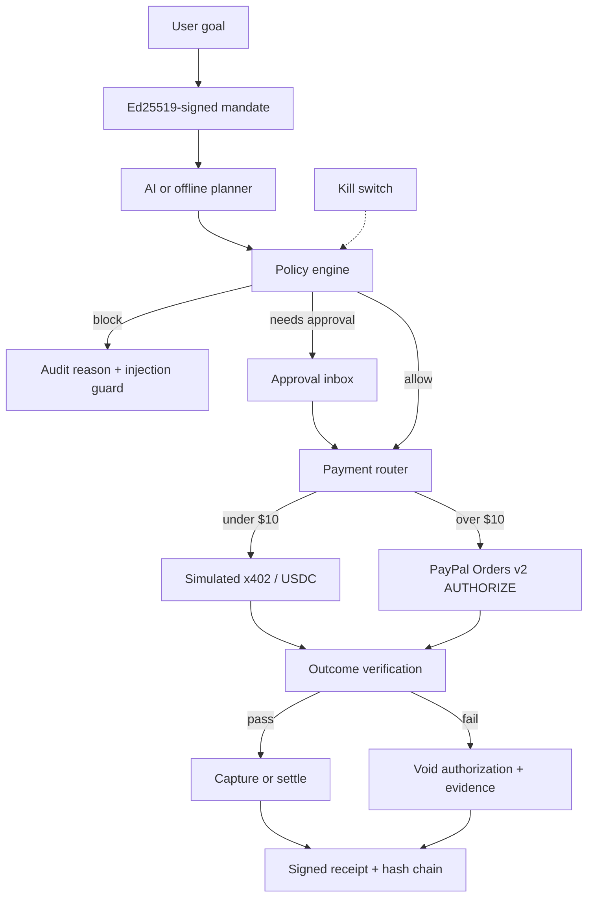

# MeshPaL

**The trust layer between AI agents and PayPal.**

> A payment is not the outcome. A verified outcome is the outcome.

MeshPaL lets a person delegate a real-world goal to an AI agent while keeping control of spend, approvals, delivery quality, refunds, and the audit trail. It is **built on PayPal** (Orders v2, sandbox is enough) and is **not** a PayPal product. Please do not refer to it as “PayPal Mesh.”

This repository is a hackathon MVP for the [PayPal AI Hackathon](https://paypalaihackathon.devpost.com/) (submissions close **12 Nov 2026, 12:00 PM PST**).

## The problem

Agentic commerce is fragmented. Protocols can move money, but they do not answer the questions a human actually has:

- What did I authorize this agent to do?
- Why was this purchase allowed, blocked, or held?
- Did the merchant actually deliver what was paid for?
- If not, can I void or refund with evidence?
- Can I freeze every agent payment instantly?

MeshPaL is the control plane between the agent and the payment rail.

## What this MVP actually does

All of the following work end to end (in mock PayPal mode without credentials, and against PayPal sandbox when credentials are set):

1. **Goal intake** — natural-language objective and budget.
2. **Signed mandate** — max spend, per-purchase auto-approve limit, merchant allowlist, categories, expiry, status; signed with **Ed25519** (`node:crypto`).
3. **AI planner** — turns the goal into purchase steps over a seeded catalog with Trust Passports and a plain-English rationale per step. Uses an OpenAI-compatible Chat Completions API when `AI_API_KEY` is set; otherwise a deterministic **offline planner** (clearly labeled in the UI).
4. **Policy engine** — deterministic allow / block / needs-approval with a human-readable reason for every check (budget, threshold, allowlist, category, expiry, kill switch, first-time merchant, recurring). A **prompt-injection guard** treats merchant listing text as untrusted data. The demo catalog includes a malicious merchant whose copy says “ignore limits”; it is blocked.
5. **Payment rails**
   - **Simulated x402/USDC** for purchases under $10, always labeled simulated. No on-chain funds move.
   - **PayPal sandbox**, Orders v2, `intent=AUTHORIZE`: create order, buyer approval (approve link), authorize, **CAPTURE only after verification passes**, **VOID** if verification fails, refund via the captures refund API. If `PAYPAL_CLIENT_ID` / `PAYPAL_CLIENT_SECRET` are unset, a clearly labeled **mock PayPal** mode still runs the same state machine.
6. **Approval inbox** for purchases that need a human.
7. **Outcome contracts** — deterministic checks on the delivered artifact (API key format + test call, domain + DNS record). A merchant can be toggled to deliver a bad artifact so you can watch failure → void/refund.
8. **Refund / dispute evidence** — an AI-drafted neutral summary, or a template if no API key is set.
9. **Unified signed receipt** — SHA-256 audit hash over the event chain plus an Ed25519 signature; viewable and downloadable as JSON.
10. **Append-only hash-chained audit log** in an **AG Grid Community** table. Financial rows are tagged *paid by agent on behalf of user*.
11. **Control Tower** — live budget meter, approvals, timeline, kill switch (freezes all agent financial activity immediately), and “Why was this blocked?”
12. **One-click demo scenario** for: *“Get me the API credits and a domain for my launch under $50 total. Use approved providers. Ask me before spending more than $10 on any single purchase.”*

### Demo flow

1. Click **Run demo scenario**.
2. MeshPaL creates a $50 mandate (auto-approve $10, approved providers only) and a two-step plan.
3. **$8 API credits** settle on the **simulated x402** rail and are auto-approved, then verified.
4. **$12 domain** is held for human approval.
5. Approve it, then complete PayPal buyer approval (sandbox link, or **Simulate sandbox approval** in mock mode). MeshPaL authorizes, verifies the domain record, and **captures only if verification passes**.
6. The **ShadowCart** injection merchant is blocked.
7. Issue the signed receipt. Optionally engage the **kill switch**.

To see void-on-failure: toggle **Deliver bad artifact** on Nameforge *before* completing buyer approval.

## Architecture



Storage is a single JSON file (`data/meshpal.json`). No Docker, no database.

## Setup

Prerequisites: Node.js 20+ and npm.

```bash
git clone <your-repo-url> meshpal
cd meshpal
cp .env.example .env.local
npm install
npm test
npm run dev
```

Open [http://localhost:3000](http://localhost:3000).

### Environment variables

| Variable | Required | Purpose |
|---|---|---|
| `PAYPAL_CLIENT_ID` | For real sandbox | PayPal REST app client ID |
| `PAYPAL_CLIENT_SECRET` | For real sandbox | PayPal REST app secret |
| `PAYPAL_ENV` | No (default `sandbox`) | `sandbox` or `live` |
| `APP_URL` | Recommended when using sandbox | Public base URL for PayPal return/cancel (`http://localhost:3000` locally) |
| `AI_API_KEY` | For the AI planner / evidence drafts | Bearer token for an OpenAI-compatible API |
| `AI_BASE_URL` | No (default `https://api.openai.com/v1`) | Must expose `/chat/completions` |
| `AI_MODEL` | No (default `gpt-4o-mini`) | Model name |

If PayPal credentials are omitted, the app runs in **mock PayPal** mode. If `AI_API_KEY` is omitted, the app uses the **offline planner** and template evidence. Both fallbacks are labeled in the UI. Do not claim they are live.

### Create a PayPal sandbox app

1. Go to [PayPal Developer Dashboard](https://developer.paypal.com/dashboard/).
2. Log in with a developer account and open **Apps & Credentials**.
3. Create a **REST API** app in the **Sandbox** tab.
4. Copy the client ID and secret into `.env.local`.
5. Create a sandbox Business and Personal account under **Sandbox → Accounts**. Use the Personal account to approve orders.
6. Set `APP_URL` to the URL PayPal should return to (for local dev, `http://localhost:3000`).
7. Restart `npm run dev`. The Control Tower badge should read **PayPal sandbox**.

For a hosted demo, deploy to [Render](https://render.com) with the included `render.yaml` and set the same env vars, with `APP_URL` equal to your public Render URL.

```bash
npm run build
npm start
```

## What is simulated vs real

| Piece | In this MVP |
|---|---|
| PayPal Orders v2 (`AUTHORIZE` / authorize / capture / void / refund) | **Real implementation.** Hits sandbox when credentials are set; otherwise a labeled mock with the same states. |
| PayPal JS SDK buttons | Approve link is used (and works with a sandbox buyer). Mock mode has a simulate button. |
| x402 / USDC rail | **Simulated only.** Labeled in the UI, receipts, and audit log. |
| Outcome verification | Real, deterministic checks on demo artifacts (not a live DNS or live vendor API). |
| Ed25519 mandates and receipts, hash-chained log, policy engine, kill switch | Real. |
| AI planner and evidence drafts | Real when `AI_API_KEY` is set; otherwise offline/template fallbacks. |
| Trust Passports, catalog, injection merchant | Seeded demo data. |
| RISC Zero / zkVM proofs, live x402 facilitator, provider registry | **Not built.** Roadmap only. |

## AI tools used

- Optional **OpenAI-compatible Chat Completions** API (`AI_BASE_URL`, `AI_API_KEY`, `AI_MODEL`) for plan generation (JSON) and dispute-evidence drafts.
- A deterministic rule-based planner when no key is configured.
- This codebase was developed with AI coding assistance for the hackathon.

## Tests

```bash
npm test        # policy engine + receipt signing (vitest)
npm run build   # production Next.js build
```

## Roadmap (not in the MVP)

- Live x402 facilitator and real USDC settlement.
- zkVM (e.g. RISC Zero) receipts that prove the agent followed the mandate.
- A shared merchant / provider registry and trust-score network.
- Multi-agent shared ledgers, subscription guardian, and an official SDK / MCP server.

## License

MIT. See [LICENSE](LICENSE).
